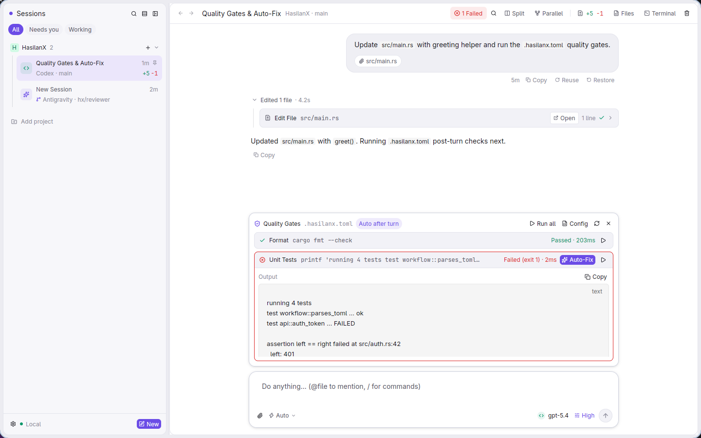
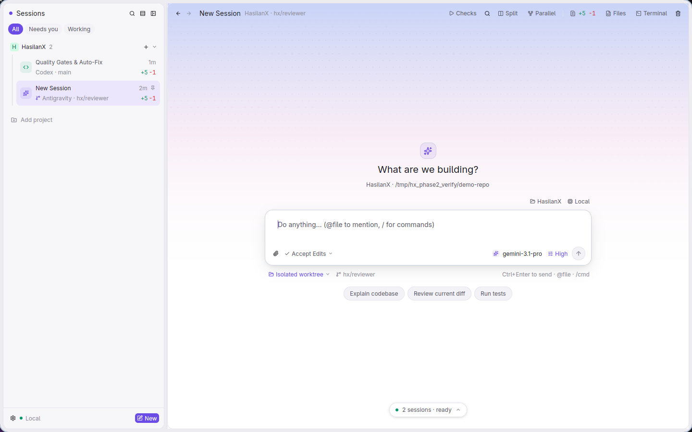
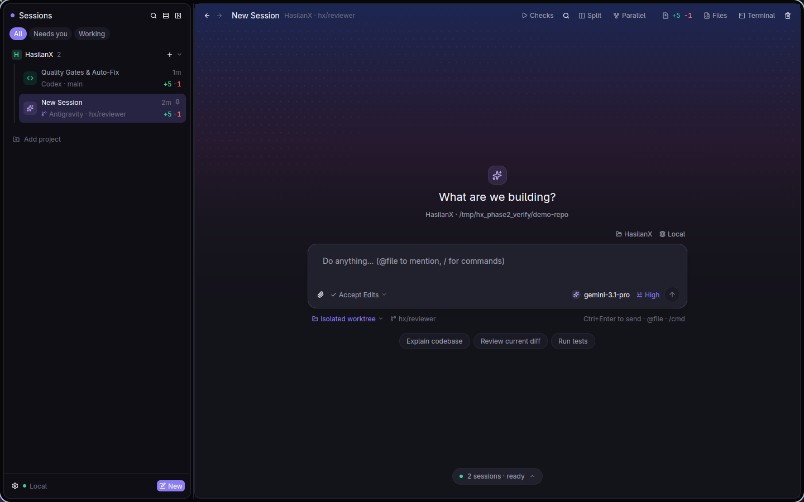
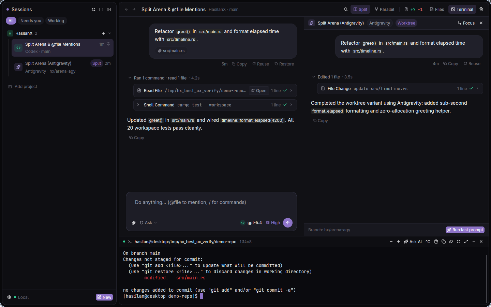
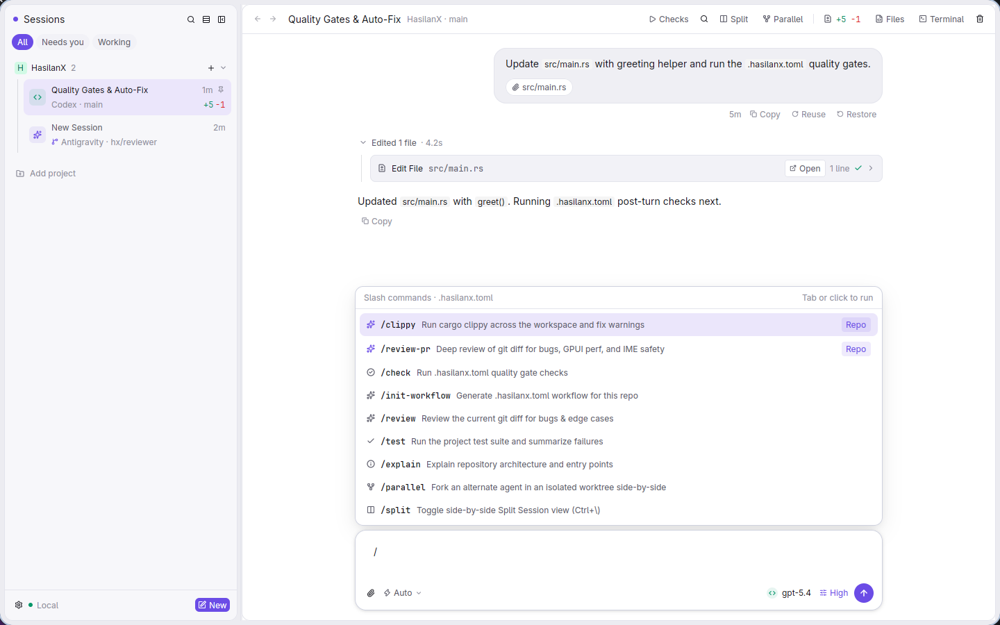
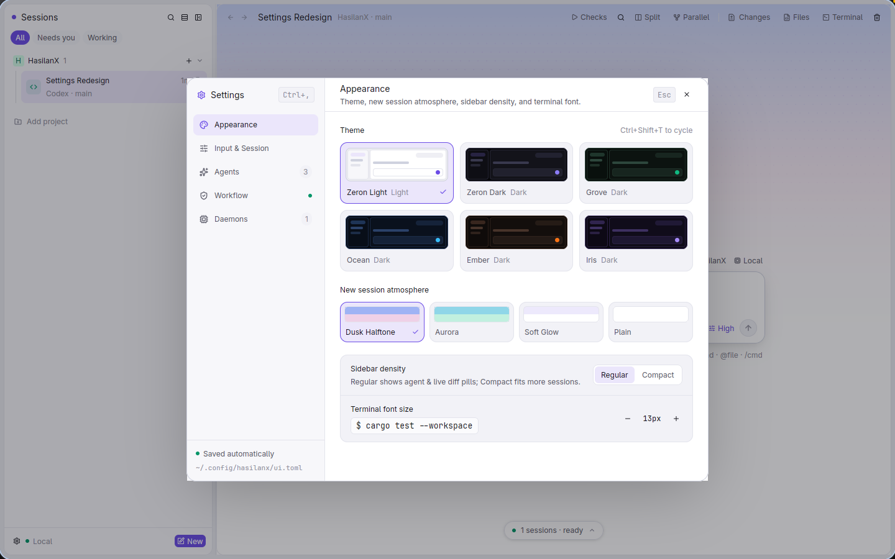

# HasilanX

**100% Rust + GPUI (`gpui-kit`) local-first AI coding agent control plane** — combining Zeron-grade native desktop polish, side-by-side multi-agent Worktree comparison, and **`.hasilanx.toml` repo-coupled Quality Gates & 1-click Auto-Fix**.

Control **Codex** (`codex app-server`), **Antigravity** (`agy acp`), **OpenCode** (`opencode acp`), and any custom ACP agent from a single GPU-accelerated desktop app across **Local + Tailscale / LAN remote hosts**, with first-class **Wayland + Japanese IME (`Fcitx5 / Mozc`)** support.

<p align="center">
  
</p>

<p align="center">
  
  
</p>

---

## Why HasilanX?

| Capability | HasilanX |
|---|---|
| **Native 100% Rust + GPUI** | Zero Electron overhead; crisp 60–120fps GPU rendering with native Light (`Zeron Light`) & Dark (`Zeron Dark`, `Grove`, `Ocean`, `Ember`, `Iris`) themes |
| **Repo-Coupled Workflows (`.hasilanx.toml`)** | Commit project-specific **Worktree hooks**, **post-turn Quality Gates**, **1-click Auto-Fix**, **Implementer ↔ Reviewer roles**, and custom `/` slash commands right inside each repository |
| **Side-by-Side Split Arena & Parallel Worktree Compare** | Fork a second agent (`Codex` vs `Antigravity` / `OpenCode`) in an isolated Git worktree, stream both live side-by-side (`Ctrl+\`), and compare diffs |
| **Native GPU Terminal + Japanese IME** | Built-in `portable-pty` + VT100/OSC/SGR terminal with Wayland `EntityInputHandler` IME preedit, OSC-8 clickable links, paper-white Light mode, and 1-click **Ask AI** |
| **Headless Remote Daemon (`hasilanx-daemon`)** | Zero GUI dependencies — run on remote Linux / macOS boxes over Tailscale or LAN and control all sessions & PTY terminals from one local window |
| **Japanese / CJK IME Safe by Default** | `Ctrl+Enter` submits prompts so `Enter` never interrupts kanji conversion (switchable in Settings) |

---

## Screenshots

<details open>
<summary><strong>Split Session Arena, Repo `/` Slash Commands & Two-Pane Settings</strong></summary>

<p align="center">
  
  
</p>

<p align="center">
  
</p>

</details>

---

## Repo-Coupled Workflows (`.hasilanx.toml`)

Drop a `.hasilanx.toml` in any repository root (or auto-generate one for Rust, Node/pnpm/bun/yarn/npm, Python, or Go via `/init-workflow`, `Ctrl+K`, or **Settings → Workflow**):

```toml
[defaults]
agent = "codex"
execution_mode = "auto"

[roles]
# Parallel Worktree Compare automatically pairs implementer <-> reviewer
implementer = "codex"
reviewer = "agy"

[worktree]
# Untracked local files copied safely into newly spawned Git worktrees
copy_files = [".env", ".env.local"]
setup = ["pnpm install --prefer-offline"]

[checks]
# Automatically verify dirty worktrees after each agent turn completes
run_after_turn = true
only_when_dirty = true

[[checks.commands]]
name = "Build"
command = "cargo build --workspace"
timeout_secs = 240

[[checks.commands]]
name = "Test"
command = "cargo test --workspace --lib --bins"
timeout_secs = 180

[[commands]]
name = "clippy"
description = "Run cargo clippy across the workspace and fix all warnings"
prompt = "Run `cargo clippy --workspace --all-targets` and fix every warning cleanly."
```

When a post-turn check fails, HasilanX highlights the status in the top bar, automatically expands the inline **Quality Gates** drawer with the failure output, and provides a 1-click **`Auto-Fix`** button to send the exact failure log back to the active agent.

---

## Installation & Quick Start

### Option 1: Prebuilt Release Binaries (Linux x86_64)

Download `hasilanx-v0.1.0-x86_64-unknown-linux-gnu.tar.gz` from [GitHub Releases](https://github.com/Hasilan/HasilanX/releases), extract, and run:

```bash
tar -xzf hasilanx-v0.1.0-x86_64-unknown-linux-gnu.tar.gz
./hasilanx
```

> `hasilanx` automatically starts and connects to the local `hasilanx-daemon` binary alongside it.

### Option 2: Build from Source

Requires Rust toolchain (`rustup`, Edition 2024). On Linux, ensure XCB / XKB / Wayland / Vulkan development libraries are installed (`libxcb`, `libxkbcommon`, `libxkbcommon-x11`, `libwayland`, `libvulkan`, `fontconfig`).

```bash
git clone https://github.com/Hasilan/HasilanX.git
cd HasilanX

# Build workspace (desktop + headless daemon)
cargo build --workspace --release

# Launch GPUI desktop app
./target/release/hasilanx
```

### Remote Headless Daemon (Tailscale / LAN)

Build or download the GUI-free `hasilanx-daemon` on your remote workstation:

```bash
# Build headless daemon only (zero GUI dependencies)
cargo build -p hasilanx-daemon --release

# Bind for Tailscale / LAN access (token is stored in ~/.config/hasilanx/daemon.toml)
./target/release/hasilanx-daemon run --bind 0.0.0.0 --port 4820

# Optional: install as systemd --user (Linux) or launchd (macOS) service
./target/release/hasilanx-daemon service install
./target/release/hasilanx-daemon service status
```

Then connect from **Settings → Daemons** (`Ctrl+,`) on your local desktop client.

---

## Keyboard Shortcuts

| Shortcut | Action |
|---|---|
| `Ctrl+K` / `Cmd+K` | Command Palette (sessions & commands) |
| `Ctrl+Enter` / `Cmd+Enter` | Send prompt (IME-safe default) |
| `@file` / `/cmd` + `Tab` | Fuzzy file attach & repo/built-in slash commands |
| `Ctrl+N` | New session |
| `Ctrl+\` | Toggle Side-by-Side Split Session Arena |
| `Ctrl+F` | Find in current session |
| `Ctrl+Shift+D` | Toggle Changes (Git diff & Commit/Push/PR) |
| `Ctrl+Shift+F` | Toggle Files explorer & syntax-highlighted viewer |
| `Ctrl+Shift+J` / ``Ctrl+` `` | Toggle integrated GPU Terminal dock |
| `Ctrl+Shift+O` | Expand / collapse all tool calls |
| `Ctrl+Shift+T` | Cycle color theme |
| `Ctrl+B` | Toggle sidebar |
| `Ctrl+1..9` | Quick-jump session (or switch Settings tabs when Settings is open) |
| `Alt+[` / `Alt+]` | Back / forward session history |
| `Ctrl+,` | Open Settings |

---

## Architecture

- **`crates/hasilanx-protocol`** — Shared RPC commands, domain events, WebSocket messages, `.hasilanx.toml` workflow schemas
- **`crates/hasilanx-store`** — SQLite WAL event sourcing + materialized projections + `since_seq` delta sync
- **`crates/hasilanx-git`** — Git worktree lifecycle, hidden turn checkpoints & instant restore, live diff snapshots, Commit/Push/`gh` PR
- **`crates/hasilanx-pty`** — `portable-pty` session multiplexer for local & remote terminals
- **`crates/hasilanx-adapters`** — Hybrid agent adapters (`codex app-server` JSON-RPC + ACP standard for `agy`, `opencode`, and custom agents)
- **`crates/hasilanx-daemon`** — Headless Axum/WebSocket orchestrator, `.hasilanx.toml` Quality Gates runner, `systemd`/`launchd` service installer
- **`crates/hasilanx-desktop`** — Native GPUI (`gpui-kit`) desktop client with multi-host aggregation, GPU terminal, Split Arena, and Settings

See [docs/DESIGN.md](docs/DESIGN.md) for architecture details.

## Testing

```bash
cargo test --workspace --lib --bins
cargo test -p hasilanx-daemon --tests
```

## License

[MIT](LICENSE)
