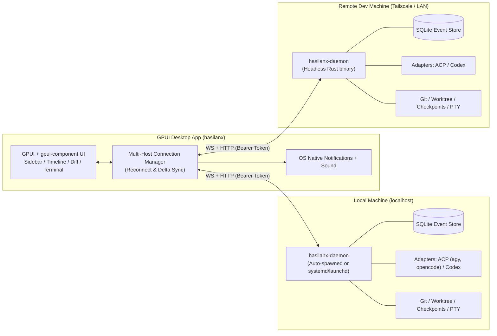

# HasilanX 設計仕様書・実装計画

> [!NOTE]
> 本ドキュメントは `/grill-me` による設計ヒアリングの結果をまとめた **HasilanX** のアーキテクチャ仕様書および段階的実装計画です。

## 1. プロジェクト概要と設計原則

**HasilanX** は、複数のローカル／リモート AI コーディングエージェントを単一の高速なネイティブ UI から並列管理・監視・操作するための、**T3 Code 準拠の個人向け統合コントロールプレーン**です。

| 項目 | 決定事項 |
| :--- | :--- |
| **プロジェクト名 / バイナリ** | `hasilanx`（デスクトップ UI: `hasilanx` / ヘッドレスデーモン: `hasilanx-daemon`） |
| **技術スタック** | **100% Rust**（UI: `gpui` + `gpui-component` / `gpui-kit`、非同期ランタイム: `tokio`、HTTP/WS: `axum`、DB: `rusqlite` / `sqlx` SQLite） |
| **対応 OS** | Linux / macOS（スマホ・Web UI は対象外） |
| **対応エージェント** | **ハイブリッド構成**: `ACP` 標準アダプタ（`agy acp` / `opencode acp` / 任意の ACP サーバー）＋ `Codex` 専用アダプタ（`codex app-server`） |
| **アーキテクチャ** | ローカル／リモート常駐デーモン ＋ マルチホスト集約型 GPUI クライアント（WebSocket + HTTP + Bearer Token） |
| **ワークスペース / Git / 機能範囲** | **T3 Code 準拠**（Local / Worktree 選択、ターン単位チェックポイント巻き戻し、ライブ Diff、Commit/Push/PR、内蔵ターミナル、Plan Mode、Steering、Prompt Queue、異種エージェント途中切替 Handoff、OS 通知＋効果音） |

---

## 2. 全体アーキテクチャ

1つの GPUI デスクトップウィンドウが、**ローカルデーモン**と**複数のリモートホスト上のデーモン**（Tailscale / LAN 経由）に同時接続し、ホストを横断してプロジェクト・スレッドを一元管理します。



### 設計上の重要ポイント
- **ヘッドレス分離**: `hasilanx-daemon` は GPUI や Wayland / X11 / Metal 等の GUI 依存を一切持たないため、リモート Linux サーバー上でも軽量にビルド・常駐できます。
- **シングルソース・オブ・トゥルース**: スレッド状態・ツール実行・承認待ち・プロンプトキューはすべてデーモン側の SQLite イベントストアが保持し、GPUI はビュー兼コマンド発行クライアントとして振る舞います。

---

## 3. Cargo ワークスペース構成

`HasilanX/` に以下のマルチクレート Cargo ワークスペースを構成します。

```text
HasilanX/
├── Cargo.toml                  # Workspace manifest (resolver = "2")
├── crates/
│   ├── hasilanx-protocol/      # 共有型: RPC Command, DomainEvent, Snapshot, Config, Error
│   ├── hasilanx-store/         # SQLite イベントストア + Projection（Read Model）構築
│   ├── hasilanx-adapters/      # AgentAdapter trait, AcpAdapter, CodexAdapter, Handoff Builder
│   ├── hasilanx-git/           # Git status/diff, Worktree 管理, 隠しツリースナップショット(Checkpoint), Commit/Push/PR
│   ├── hasilanx-pty/           # portable-pty ベースの統合ターミナルセッション管理
│   ├── hasilanx-daemon/        # バイナリ: hasilanx-daemon (Axum WS/HTTP, Orchestrator, Auth, service install)
│   └── hasilanx-desktop/       # バイナリ: hasilanx (GPUI + gpui-component UI, Multi-Host Client, Notifier)
└── docs/
    └── DESIGN.md               # リポジトリ内設計ドキュメント（必要に応じて同期）
```

---

## 4. エージェント統合レイヤー (`hasilanx-adapters`)

### 4.1 統一トレイト (`AgentAdapter`)
各エージェントの差異をデーモン内で吸収し、共通の正規化イベント（`AgentOutputEvent`）に変換します。

```rust
#[async_trait]
pub trait AgentAdapter: Send + Sync {
    fn kind(&self) -> AdapterKind; // Acp(String) | Codex
    async fn start_session(&self, req: StartSessionReq) -> Result<Box<dyn AgentSession>>;
    async fn resume_session(&self, req: ResumeSessionReq) -> Result<Box<dyn AgentSession>>;
    async fn list_models(&self) -> Result<Vec<ModelInfo>>;
}
```

### 4.2 アダプタ実装方針
1. **`AcpAdapter`（標準・拡張可能）**
   - 対象: `agy acp`、`opencode acp`、およびユーザー設定（`~/.config/hasilanx/agents.toml`）で追加した任意の ACP 準拠コマンド。
   - 通信: 子プロセス起動＋標準入出力（stdio）上の JSON-RPC 2.0（ACP 仕様）。
   - 対応機能: ストリーミングテキスト／思考ブロック、ツール呼び出し進捗、権限リクエスト（`session/request_permission`）、キャンセル、モード・モデル切替。
2. **`CodexAdapter`（専用）**
   - 対象: `codex app-server`（JSON-RPC 経由でスレッド・ターン・承認・モデル・reasoning effort・diff 適用を制御）。
   - Codex 固有機能（sandbox モード、approval policy、mid-run steering 等）をネイティブに活用。

### 4.3 異種エージェント途中切替（自動 Handoff）
同一スレッド内でエージェントを切り替えた場合（例: `Codex` → `agy acp`）：
- **同種エージェント内のモデル／Effort／Mode 切替**: ネイティブセッションを維持したまま設定を更新。
- **異種エージェントへの切替**: デーモンがイベントストアから以下を自動生成し、新しいエージェントセッションの初期コンテキスト（Handoff ブロック）として注入してシームレスに継続。
  1. これまでの会話履歴要約＋直近数ターンの原文
  2. 対象スレッドの現在ブランチ・変更ファイル一覧・未コミット Diff 要約
  3. 完了済み／進行中の計画（Plan がある場合）

---

## 5. イベントソーシング & SQLite 永続化 (`hasilanx-store`)

T3 Code と同様、すべての状態遷移を **Command → Append-only Event → Projection** の流れで処理します。

### 5.1 主要テーブル設計
- `events (seq INTEGER PRIMARY KEY AUTOINCREMENT, event_id TEXT UNIQUE, thread_id TEXT, project_id TEXT, kind TEXT, payload_json TEXT, created_at INTEGER)`
  - デーモン全体で単調増加する `seq` を付与。クライアントは接続時に `since_seq` を送るだけで欠損ゼロの差分同期（Delta Replay）が可能。
- **Projection（Read Model）テーブル**（高速起動・一覧描画用、イベントから再構築可能）:
  - `projects`: id, name, root_path, created_at
  - `threads`: id, project_id, title, workspace_mode (`local` | `worktree`), worktree_path, branch_name, active_agent_id, active_model, execution_mode (`ask` | `accept_edits` | `auto` | `plan`), status (`idle` | `running` | `waiting_approval` | `error`), vendor_session_json, updated_at
  - `turns`: id, thread_id, turn_index, user_prompt, status, checkpoint_before_ref, checkpoint_after_ref, started_at, finished_at
  - `pending_approvals`: id, thread_id, turn_id, tool_name, args_json, status
  - `prompt_queue`: id, thread_id, position, prompt_text, attachments_json

### 5.2 ワークフロー制御（Steering / Queue / Plan）
- **Queue**: `status == running` 中に通常送信されたプロンプトは `prompt_queue` に積まれ、現在ターン完了直後にデーモンが自動ディスパッチ。
- **Steering**: 実行中に「今すぐ指示（Steer）」を実行すると、対応アダプタ（Codex 等）にはネイティブ介入を送り、非対応 ACP エージェントには現在ターンへの割込みキャンセル＋コンテキスト付き再送で同等動作を実現。
- **Plan Mode**: モードが `plan` の場合はエージェント側プランモード（または読み取り専用ツール制約）で計画を生成させ、UI 上に「Plan 承認して実行」ボタンを表示。

---

## 6. ワークスペース・Git・チェックポイント設計 (`hasilanx-git`)

T3 Code 準拠のワークスペースモデルを採用します。

1. **Workspace Mode（スレッド作成時に選択）**
   - **Local**: プロジェクトルートディレクトリ上で直接実行。
   - **Worktree**: `.hasilanx/worktrees/<thread-slug>`（または設定パス）に独立した Git Worktree ＋専用ブランチを自動作成して隔離実行。スレッド削除時にクリーンアップ可能。
2. **ターン単位チェックポイント（ロールバック）**
   - 各ターンの開始前・終了後に、一時インデックス（`GIT_INDEX_FILE`）を使って `git add -A` + `git write-tree` を実行し、隠し Ref（`refs/hasilanx/checkpoints/<thread_id>/<turn_idx>_{before,after}`）へ保存。
   - ユーザーの作業ブランチ履歴や `git stash` を一切汚さず、未追跡ファイルを含めて正確なターン間 Diff 表示とワンクリック復元が可能。
3. **ライブ Diff & Git 操作**
   - ファイル単位の変更監視（`notify` クレート）＋ターン完了イベントを契機に Diff を計算して WebSocket 配信。
   - UI からステージング・コミット・プッシュ・PR 作成（`gh pr create` 連携）を実行可能。

---

## 7. 通信プロトコル & セキュリティ (`hasilanx-protocol`)

- **トランスポート**:
  - `GET /api/v1/health` — ヘルスチェック・バージョン・対応エージェント一覧
  - `GET /api/v1/snapshot?since_seq=<N>` — 初期スナップショットまたは差分イベント取得
  - `WS /api/v1/ws` — 双方向 JSON-RPC（コマンド送信・イベント購読・PTY ストリーム）
- **認証**:
  - 初回起動時にランダムな 256-bit Bearer Token を `~/.config/hasilanx/daemon.toml` に自動生成。
  - ローカル接続時は設定ファイルから自動読み込み、リモート接続（Tailscale / LAN）時は GPUI のホスト設定に URL + Token を登録（`Authorization: Bearer <token>`）。
  - デフォルトのバインドアドレスは `127.0.0.1:4820`（リモート公開時はユーザーが `--bind 0.0.0.0:4820` または Tailscale IP を明示設定）。

---

## 8. GPUI デスクトップ UI & UX 設計 (`hasilanx-desktop`)

`gpui` + `gpui-component`（`gpui-kit`）を活用し、Zed のような軽快な 120 FPS ネイティブ操作感を目指します。

### 8.1 レイアウト構成
- **左サイドバー（Resizable）**
  - ホスト（`Local` / リモートホスト名＋接続状態ドット）→ プロジェクト → スレッドの階層ツリー。
  - 各スレッドにリアルタイム状態バッジ（実行中スピナー / **承認待ちハイライト** / 完了未読 / エラー）。
  - 上部に「承認待ちのみ表示」フィルタと新規スレッド作成ボタン。
- **中央ペイン（タイムライン & コンポーザ）**
  - 仮想スクロール対応タイムライン：Markdown レンダリング、折りたたみ可能な Thinking ブロック、構造化 Tool Call カード（コマンド・編集ファイル・結果）、ターン毎の「ここまで戻す（Revert）」アクション。
  - 権限承認バー（承認 / 今回のみ許可 / 拒否 / 編集して実行）。
  - 下部コンポーザ：マルチライン入力、ファイル・画像添付、エージェント切替（Handoff 対応）、モデル・Effort・Mode（Ask/Accept Edits/Auto/Plan）セレクタ、送信 / Queue 追加 / Steer 切替。
- **右ペイン（トグル可能・Resizable）**
  - ライブ Diff ビューア（Unified / Split 切替、変更ファイル一覧、チェックポイント間 Diff）。
  - Git アクションバー（ブランチ表示、Commit メッセージ入力、Push、PR 作成）。
- **下部ドック（トグル可能・Resizable）**
  - 統合 PTY ターミナル（デーモン側の `portable-pty` と WS 接続し、クライアント側は `alacritty_terminal` で VT エミュレーション描画）。リモートホストのシェルも透過的に操作可能。
- **キーボード中心 UX & 通知**
  - コマンドパレット（`Cmd/Ctrl+K`）、スレッド切替、ペイン開閉、承認ショートカット。
  - OS ネイティブ通知（`notify-rust` 等で Linux D-Bus / macOS 通知センター対応＋クリックで該当ホスト・スレッドへフォーカス）および効果音。

---

## 9. デーモン起動・常駐ライフサイクル

1. **自動起動**: `hasilanx`（GPUI）起動時、設定されたローカルデーモンへ接続を試み、未起動なら同じ PATH / 隣接ディレクトリの `hasilanx-daemon` をバックグラウンドで自動スポーン。
2. **サービス常駐コマンド**:
   - `hasilanx-daemon service install` / `uninstall` / `status`
   - Linux: `~/.config/systemd/user/hasilanx-daemon.service` を生成・有効化
   - macOS: `~/Library/LaunchAgents/dev.hasilanx.daemon.plist` を生成・ロード

---

## 10. 段階的実装ロードマップと検証計画

毎フェーズ終了時に「実際に手元で動かして日常利用できる垂直スライス」が完成するよう、4フェーズで実装します。

### Phase 1: コア基盤 ＋ エージェント実行 ＋ GPUI 基本チャット（MVP）
- Cargo ワークスペース構築（`protocol`, `store`, `adapters`, `daemon`, `desktop`）
- SQLite イベントストア（`events` + 基本 projections）と `since_seq` 差分同期
- Axum WebSocket / HTTP サーバー＋Bearer Token 認証
- `AcpAdapter`（`agy acp` / `opencode acp` 実機疎通）＋ `CodexAdapter`（`codex app-server` 実機疎通）
- GPUI 基本ウィンドウ：左サイドバー（Project/Thread＋状態バッジ）、中央タイムライン（Markdown・Tool Call・権限承認 UI）、コンポーザ（エージェント/モデル選択）、ローカルデーモン自動起動
- **検証**: `cargo test`（イベントストア・プロトコル単体テスト）＋実機で `agy acp` / `opencode acp` / `codex` の3種すべてを並列起動・承認・再接続リプレイ確認

### Phase 2: Worktree・チェックポイント・ライブ Diff・Git 操作
- `hasilanx-git` クレート実装：Local / Worktree 作成・破棄、一時インデックスによるターン毎隠しチェックポイント保存＆ロールバック
- ファイル監視＋ライブ Diff ストリーミング
- GPUI 右ペイン：Diff ビューア、Git ステータス、Commit / Push / PR 作成（`gh` 連携）、ターンからのワンクリック Revert
- **検証**: テスト用 Git リポジトリでの Worktree 作成・チェックポイント復元・Diff 精度の統合テスト＋GPUI 実機確認

### Phase 3: 統合ターミナル・高度なオーケストレーション・Handoff
- `hasilanx-pty`（`portable-pty`）＋ WS バイナリ/チャンク転送＋ GPUI 下部ドック（`alacritty_terminal` 描画）
- Prompt Queue・Mid-run Steering・Plan Mode UI
- 異種エージェント途中切替時の自動コンテキスト Handoff 実装
- コマンドパレット・ファイル／画像添付・キーボードショートカット整備
- **検証**: 実行中スレッドへの Queue 追加・Steer 割込み、`codex` ↔ `agy acp` 間の途中切替、内蔵ターミナル入出力（色・リサイズ・Vim/TUI 等）の動作確認

### Phase 4: マルチホスト接続・OS 通知・常駐化
- GPUI マルチホスト接続マネージャ（ローカル＋複数リモートホストの並列接続・再接続バックオフ・サイドバー統合表示）
- OS ネイティブデスクトップ通知（クリックでスレッドへフォーカス）＋効果音
- `hasilanx-daemon service install`（Linux `systemd --user` / macOS `launchd`）
- **検証**: 複数デーモン（別ポート／別ホスト）への同時接続・ネットワーク断からの自動復旧・通知クリックフォーカス・`systemd --user` 常駐テスト
